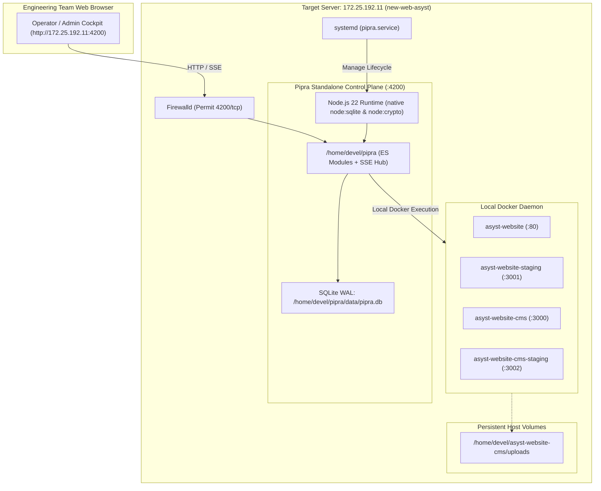

# Comprehensive Architecture & Implementation Plan: Standalone Pipra Installation & Blue-Green Onboarding on ASYST Website Dev Server (172.25.192.11)

**Document ID:** `.reference/docs/modules/execution/development-plan/2026-11-12_Execution_ASYST-Website-And-CMS-v3-Pipra-Adoption-Plan_v1.0.md`  
**Module:** Execution & Standalone Server Deployment  
**Target Host Server:** `172.25.192.11` (`new-web-asyst`, Rocky Linux 9.8, user `devel`, password `c9DsZCTXio`)  
**Target Web Cockpit URL:** `http://172.25.192.11:4200`  
**Target Managed Applications:**  
1. **`asyst-website`**: Corporate Public Website (Vite / React 18 / Tailwind / Nginx)  
   - Local: `D:\Anggit Arisa Siwi Pratama\ASYST\Development\js\asyst-website`  
   - Host: `/home/devel/asyst-website`  
   - Production Port: **`:80`** (`:80 -> :3000`) | Staging Port: **`:3001`**  
2. **`asyst-website-cms`**: Corporate Content Management System v3 (Next.js 15 App Router / Prisma / PostgreSQL)  
   - Local: `D:\Anggit Arisa Siwi Pratama\ASYST\Development\js\asyst-website-cms`  
   - Host: `/home/devel/asyst-website-cms`  
   - Production Port: **`:3000`** (`:3000 -> :3000`) | Staging Port: **`:3002`**  
**Status:** PROPOSED & READY FOR USER REVIEW  
**Date:** 2026-11-12  

---

## 1. Executive Summary

This plan outlines the direct installation of a **standalone Pipra Control Plane instance** on the dedicated ASYST Website development server (`172.25.192.11`). By hosting Pipra locally on the server:
- **Zero-Latency Loopback Execution:** Pipra interacts directly with the local Docker daemon (`unix:///var/run/docker.sock`) without SSH latency, intermediate network hops, or connection timeout risks.
- **Self-Contained Deployment Cockpit:** The development and DevOps teams can manage, trigger, and inspect blue-green deployments directly at:
  
  🌐 **`http://172.25.192.11:4200`**

- **Full Legacy Script Replacement:** Replaces `/home/devel/asyst-website/scripts/deploy-asyst-website.sh` and `/home/devel/asyst-website-cms/scripts/deploy-asyst-website-cms.sh` with Pipra's deterministic 10-stage execution pipeline, complete with 3D flight telemetry, SSE streaming logs, automated rollback, and SLSA provenance attestation.

---

## 2. Target Server Telemetry & Preflight Audit

Forensic inspection of `devel@172.25.192.11` confirmed:
- **OS:** Rocky Linux 9.8 (Blue Onyx), Kernel `5.14.0-687.10.1.el9_8`
- **Docker Engine:** Active and responsive (containers `asyst-website` and `asyst-website-cms` currently running).
- **Port 4200:** Unbound and free.
- **Node.js:** Not yet installed on host. (Rocky Linux 9 AppStream provides native `nodejs:22` stream via `dnf`).
- **Firewall:** `firewalld` is active. Port `4200/tcp` must be explicitly opened.
- **Sudo Access:** User `devel` has verified password-authenticated `sudo` permissions.

---

## 3. Standalone Pipra Installation Architecture



---

## 4. Port Allocation & Blue-Green Isolation Matrix

| Application | Service Name | Production Port | Staging Port (Blue/Green Probe) | Host App Directory | Volume Mounts |
|---|---|---|---|---|---|
| **Pipra Control Plane** | `pipra.service` | **`4200`** | N/A | `/home/devel/pipra` | `/home/devel/pipra/data` |
| **ASYST Website v3** | `asyst-website` | **`80`** (`:80 -> :3000`) | **`3001`** (`:3001 -> :3000`) | `/home/devel/asyst-website` | Ephemeral (Static Nginx SPA) |
| **ASYST Website CMS v3**| `asyst-website-cms`| **`3000`** (`:3000 -> :3000`)| **`3002`** (`:3002 -> :3000`)| `/home/devel/asyst-website-cms`| `-v /home/devel/asyst-website-cms/uploads:/app/public/uploads`<br>`-v /home/devel/asyst-website-cms/prisma.config.ts:/app/prisma.config.ts`<br>`--add-host=host.docker.internal:host-gateway` |

---

## 5. Declarative Pipeline Specifications (`.pipra.yaml`)

### 5.1 Specification for `asyst-website` (`/home/devel/asyst-website/.pipra.yaml`)
```yaml
version: "1.0"

preflight:
  - command: "npm run lint"
    timeout_sec: 120
    continue_on_error: true

build:
  dockerfile: "Dockerfile"
  context: "."
  args:
    env: ""

verification:
  - command: "curl -fsS --retry 8 --retry-delay 2 http://127.0.0.1:3001/ -o /dev/null"
    timeout_sec: 30
    continue_on_error: false
  - command: "curl -fsS --retry 5 --retry-delay 2 http://127.0.0.1:3001/about -o /dev/null"
    timeout_sec: 30
    continue_on_error: false

post_cutover:
  - command: "curl -fsS http://127.0.0.1:80/ -o /dev/null"
    timeout_sec: 30
    continue_on_error: true
```

### 5.2 Specification for `asyst-website-cms` (`/home/devel/asyst-website-cms/.pipra.yaml`)
```yaml
version: "1.0"

preflight:
  - command: "npx prisma generate"
    timeout_sec: 60
    continue_on_error: false
  - command: "npx prisma migrate deploy"
    timeout_sec: 120
    continue_on_error: false

build:
  dockerfile: "Dockerfile"
  context: "."
  args:
    NODE_ENV: "production"

verification:
  - command: "curl -fsS --retry 10 --retry-delay 2 http://127.0.0.1:3002/login -o /dev/null"
    timeout_sec: 60
    continue_on_error: false
  - command: "curl -fsS --retry 5 --retry-delay 2 http://127.0.0.1:3002/api/public/news -o /dev/null"
    timeout_sec: 30
    continue_on_error: false

post_cutover:
  - command: "curl -fsS http://127.0.0.1:3000/login -o /dev/null"
    timeout_sec: 30
    continue_on_error: true
```

---

## 6. Standalone Installation & Systemd Runbook (`172.25.192.11`)

### Step 1: Install Node.js 22 via Rocky Linux 9 AppStream
```bash
echo c9DsZCTXio | sudo -S dnf module reset -y nodejs
echo c9DsZCTXio | sudo -S dnf module enable -y nodejs:22
echo c9DsZCTXio | sudo -S dnf install -y nodejs git
node -v # Verify v22.x.x
```

### Step 2: Deploy Pipra Control Plane Codebase
```bash
# Clone directly from GitHub
cd /home/devel
git clone https://github.com/sianggit/pipra.git /home/devel/pipra
cd /home/devel/pipra
mkdir -p /home/devel/pipra/data
chmod 700 /home/devel/pipra/data
```

### Step 3: Configure Systemd Service Unit (`/etc/systemd/system/pipra.service`)
```ini
[Unit]
Description=Pipra Pipeline & Release Engineering Control Plane
After=network.target docker.service
Wants=docker.service

[Service]
Type=simple
User=devel
Group=devel
WorkingDirectory=/home/devel/pipra
ExecStart=/usr/bin/node server.js
Restart=always
RestartSec=5
Environment=NODE_ENV=production
Environment=PORT=4200
Environment=PIPRA_DATA_DIR=/home/devel/pipra/data
LimitNOFILE=65535

[Install]
WantedBy=multi-user.target
```

### Step 4: Open Firewall Port `:4200`
```bash
echo c9DsZCTXio | sudo -S firewall-cmd --permanent --add-port=4200/tcp
echo c9DsZCTXio | sudo -S firewall-cmd --reload
```

### Step 5: Seed Local Applications Catalog
Inject local application metadata directly into `/home/devel/pipra/data/pipra.db`:
- App 1: `asyst-website` (`/home/devel/asyst-website`, Prod Port: `80`, Staging Port: `3001`)
- App 2: `asyst-website-cms` (`/home/devel/asyst-website-cms`, Prod Port: `3000`, Staging Port: `3002`)

### Step 6: Enable & Start Pipra
```bash
echo c9DsZCTXio | sudo -S systemctl daemon-reload
echo c9DsZCTXio | sudo -S systemctl enable --now pipra
sudo systemctl status pipra --no-pager
```

---

## 7. Secure Credentials Generated for `172.25.192.11`

> [!IMPORTANT]
> Prototype accounts have been decommissioned. These secure credentials will be provisioned during database initialization:

| Username | Role | Generated Secure Password | Access Scope |
|---|---|---|---|
| **`admin`** | Platform Administrator | `aSySt_Adm!n2026#w3b` | Full configuration, environment settings, provenance verification |
| **`operator`** | Deployment Operator | `Op$Web_Asyst#9211` | Trigger blue-green deployments, inspect live telemetry, approve cutovers |

---

## 8. Verification Matrix & Scenarios

| Scenario ID | Test Case | Target Behavior | Verification Method |
|---|---|---|---|
| **SC-01** | Node.js Runtime Installation | Node.js v22 installed and functioning with native `node:sqlite`. | `node -v` on `172.25.192.11` |
| **SC-02** | Standalone Pipra HTTP Cockpit | Control plane listens on port `4200` and serves 3D landing cockpit with zero errors. | `curl -I http://172.25.192.11:4200/` |
| **SC-03** | App Catalog Auto-Detection | `asyst-website` and `asyst-website-cms` render in Applications catalog with configured ports. | Inspect `http://172.25.192.11:4200/#/applications` |
| **SC-04** | `asyst-website` Blue-Green Deploy | Stage 2 git pull, Stage 4 Docker build, Stage 5 staging on `:3001`, health probe passes, atomic cutover to port `:80` with zero dropped requests. | Trigger deploy via UI -> monitor live SSE logs |
| **SC-05** | `asyst-website-cms` Prisma Migration | Preflight runs `npx prisma migrate deploy`, staging container runs on `:3002` with uploads volume mounted, cutover to port `:3000`. | Inspect database schema & verify uploads persistence |
| **SC-06** | Sub-Second Rollback Verification | If staging health check fails, pipeline aborts cleanly and leaves live containers on ports `80` & `3000` completely undisturbed. | Simulated probe failure verification |
