# Comprehensive Architecture & Implementation Plan: Seamless Onboarding of ASYST Website & ASYST Website CMS v3 to Pipra Blue-Green Deployment Engine

**Document ID:** `.reference/docs/modules/execution/development-plan/2026-11-12_Execution_ASYST-Website-And-CMS-v3-Pipra-Adoption-Plan_v1.0.md`  
**Module:** Execution & Multi-App Delivery  
**Target Applications:**  
1. **`asyst-website`** (Public Corporate Website — Vite / React 18 / Tailwind / Nginx)  
2. **`asyst-website-cms`** (Corporate Content Management System v3 — Next.js App Router / Prisma / PostgreSQL)  
**Target Environment:** Development & Staging Server (`172.25.230.100` / Rocky Linux 9)  
**Reference Manual Script:** `deploy-asyst-web-next.sh` (Legacy Blue-Green Bash)  
**Status:** PROPOSED & READY FOR USER REVIEW  
**Date:** 2026-11-12  

---

## 1. Executive Summary & Objectives

The ASYST engineering team currently relies on manual shell scripts (`deploy-asyst-web-next.sh`) executed over interactive SSH sessions to deploy frontend and CMS workloads. While functional, manual shell executions introduce significant operational risks:
- Lack of centralized audit trail and delivery governance.
- Blind execution without sub-second log streaming, diagnostics, or SLSA supply-chain attestations.
- Risk of shell connection aborts (e.g. SSH dropouts leaving stale staging containers or port deadlocks).
- Manual secret file handling and absence of role-based approval barriers (Two-Person Rule).

This implementation plan outlines the seamless migration of both **`asyst-website`** and **`asyst-website-cms`** into **Pipra**, transforming the legacy bash script logic into a deterministic, zero-downtime, automated 10-stage blue-green deployment pipeline orchestrated from the web cockpit at:

🌐 **`http://172.25.230.100:4200`**

---

## 2. Legacy Bash Script vs. Pipra 10-Stage Pipeline Mapping

Pipra natively implements the exact blue-green deployment lifecycle previously written in `deploy-asyst-web-next.sh`, elevated to an enterprise-grade control plane:

```mermaid
flowchart TD
    subgraph Legacy_Manual_Script["Legacy Bash Script (deploy-asyst-web-next.sh)"]
        S1["Step 1-3: git fetch && git pull"]
        S2["Step 4: docker build"]
        S3["Step 5: docker run --name *-staging"]
        S4["Step 6: curl health loop (15 attempts)"]
        S5["Step 7-8: rename to backup & run prod"]
        S6["Step 9: curl prod verification & rollback"]
    end

    subgraph Pipra_Deterministic_Pipeline["Pipra 10-Stage Deterministic Engine"]
        P1["Stage 1: QUEUED (Lock acquisition & role verification)"]
        P2["Stage 2: SOURCE_PULL (Git sync & .pipra.yaml discovery)"]
        P3["Stage 3: PREFLIGHT (Linting, TypeScript check & DB migrations)"]
        P4["Stage 4: CONTAINER_BUILD (BuildKit multi-stage Docker build)"]
        P5["Stage 5: STAGING_SPINUP (Launch Blue/Green staging container)"]
        P6["Stage 6: HEALTH_PROBES (Sub-second HTTP telemetry assertions)"]
        P7["Stage 7: PROMOTION_GATE (Interactive Two-Person approval)"]
        P8["Stage 8: CUTOVER_EXECUTION (Atomic container replacement)"]
        P9["Stage 9: POST_CUTOVER_VERIFY (Production smoke verification)"]
        P10["Stage 10: ATTESTATION_FINALIZED (SLSA v0.2 cryptographic signing)"]
    end

    S1 --> P2
    S2 --> P4
    S3 --> P5
    S4 --> P6
    S5 --> P8
    S6 --> P9
```



### 2.1 1:1 Parameter Mapping Matrix

| Legacy CLI Flag | `deploy-asyst-web-next.sh` Default | Pipra First-Class Attribute | Pipra Database Field | Purpose |
|---|---|---|---|---|
| `--branch` | `devel` / `main` | Target Branch | `deployments.branch` | Git branch to synchronize and deploy. |
| `--tag` | `vX.X.X` / `date +%s` | Release Tag | `deployments.image_tag` | Docker image tag (`asyst-website:<tag>`). |
| `--name` | `asyst-web` | Container / Slug Name | `applications.slug` / `applications.name` | Production Docker container identifier. |
| `--port` | `3000` / `8080` | Production Port | `application_environments.host_port` | Live customer-facing host port. |
| `--staging-port` | `3001` / `8081` | Staging Port | `application_environments.staging_port` | Ephemeral port for pre-cutover verification. |
| `--env-file` | `.env.production` | Environment File | `application_environments.env_file` | Secret configuration file mounted to build/run. |
| `--dockerfile` | `Dockerfile.jenkins` / `Dockerfile` | Dockerfile Path | `applications.dockerfile` | Multi-stage Docker recipe in repository root. |
| `--app-dir` | `/home/devel/asyst-web` | Host App Directory | `application_environments.app_dir` | Absolute target directory containing the git clone. |
| `--skip-pull` | `false` | Skip Git Pull | `options.skipPull` | Skips remote fetch if re-deploying local commit. |
| `--verify-local` | `false` | Host Local Verification | `application_environments.enable_local_verification` | Runs local preflight build before containerization. |

---

## 3. Application Profiles & Architectural Specifications

### 3.1 Application 1: `asyst-website` (Public Corporate Portal)

- **Architecture:** React 18, Vite, TypeScript, Tailwind CSS, Radix UI.
- **Serving Strategy:** Multi-stage build producing static bundle served via high-performance Nginx reverse-proxy.
- **Port Allocation:**
  - Production Port: **`3010`** (Mapped from container port `:3000`)
  - Staging Port: **`3011`** (Ephemeral staging probe port)
- **Host Workspace:** `/home/devel/asyst-website`
- **Permitted Branches:** `main, develop, staging, release/*, hotfix/*`
- **Dockerfile Modernization:**
  Update `Dockerfile` to support zero-dependency multi-stage build directly on host:
  ```dockerfile
  # Multi-stage Dockerfile for asyst-website
  FROM node:22-bookworm-slim AS builder
  WORKDIR /app
  COPY package*.json ./
  RUN npm ci
  COPY . .
  ARG RUNTIME_ENV=prd
  ENV RUNTIME_ENV=${RUNTIME_ENV}
  RUN node ./initialize/index.cjs && npx tsc && npx vite build --mode=${RUNTIME_ENV}

  FROM nginx:alpine AS runner
  COPY ./nginx.conf /etc/nginx/nginx.conf
  COPY --from=builder /app/dist /usr/share/nginx/apps
  EXPOSE 3000
  CMD ["nginx", "-g", "daemon off;"]
  ```

### 3.2 Application 2: `asyst-website-cms` (Corporate CMS v3)

- **Architecture:** Next.js 15 App Router, React 19, TypeScript, Prisma ORM, PostgreSQL.
- **Runtime Strategy:** Node.js 22 standalone production server with Prisma database client.
- **Port Allocation:**
  - Production Port: **`3020`** (Mapped from container port `:3000`)
  - Staging Port: **`3021`** (Ephemeral staging probe port)
- **Host Workspace:** `/home/devel/asyst-website-cms`
- **Persistent Data & Uploads Volume:**
  - Host directory `/home/devel/asyst-website-cms/uploads` mounted into container at `/app/public/uploads` to preserve media library across blue-green container replacements.
- **Preflight Requirement:** Database migration check (`npx prisma migrate deploy`) during preflight stage.

---

## 4. Declarative Pipeline Specifications (`.pipra.yaml`)

### 4.1 Declarative Spec for `asyst-website` (`/home/devel/asyst-website/.pipra.yaml`)

```yaml
version: "1.0"

# Preflight: Ensure clean linting and types before Docker containerization
preflight:
  - command: "npm run lint"
    timeout_sec: 120
    continue_on_error: true

# Build specification
build:
  dockerfile: "Dockerfile"
  context: "."
  args:
    RUNTIME_ENV: "prd"

# Staging verification: Probe HTTP health on ephemeral staging port
verification:
  - command: "curl -fsS --retry 5 --retry-delay 2 http://127.0.0.1:3011/ -o /dev/null"
    timeout_sec: 45
    continue_on_error: false

# Post-cutover verification: Confirm production route health
post_cutover:
  - command: "curl -fsS http://127.0.0.1:3010/ -o /dev/null"
    timeout_sec: 30
    continue_on_error: true
```

### 4.2 Declarative Spec for `asyst-website-cms` (`/home/devel/asyst-website-cms/.pipra.yaml`)

```yaml
version: "1.0"

# Preflight: Automated Prisma schema migration before container build
preflight:
  - command: "npx prisma generate"
    timeout_sec: 60
    continue_on_error: false
  - command: "npx prisma migrate deploy"
    timeout_sec: 120
    continue_on_error: false

# Build specification
build:
  dockerfile: "Dockerfile"
  context: "."
  args:
    NODE_ENV: "production"

# Staging verification: Probe CMS health endpoint on port 3021
verification:
  - command: "curl -fsS --retry 8 --retry-delay 2 http://127.0.0.1:3021/ -o /dev/null"
    timeout_sec: 60
    continue_on_error: false

# Post-cutover verification: Confirm live CMS portal is operational
post_cutover:
  - command: "curl -fsS http://127.0.0.1:3020/ -o /dev/null"
    timeout_sec: 30
    continue_on_error: true
```

---

## 5. Host Server Port & Volume Topology Matrix (`172.25.230.100`)

| Subsystem | Container Name | Production Port | Staging Port | Workspace Directory | Persistent Volumes |
|---|---|---|---|---|---|
| **Pipra Control Plane** | `pipra` (Systemd) | `4200` | N/A | `/home/devel/pipra` | `/home/devel/pipra/data` |
| **ASDP DIMS Frontend** | `asdp-dims-fe` | `3000` | `3001` | `/home/devel/asdp-dims-fe` | Ephemeral |
| **ASYST Website** | `asyst-website` | `3010` | `3011` | `/home/devel/asyst-website` | Ephemeral |
| **ASYST Website CMS v3**| `asyst-website-cms` | `3020` | `3021` | `/home/devel/asyst-website-cms`| `-v /home/devel/asyst-website-cms/uploads:/app/public/uploads` |

---

## 6. Pipra Catalog Registration (Database Seed & SQL Setup)

To register both applications in Pipra's SQLite database (`/home/devel/pipra/data/pipra.db`), execute the following automated SQL migration:

```sql
-- 1. Register asyst-website
INSERT OR IGNORE INTO applications (
  id, name, slug, git_repo_url, default_branch, permitted_branches, 
  dockerfile, default_host_app_dir, default_prod_port, default_staging_port, created_at, updated_at
) VALUES (
  'app_asyst_website',
  'ASYST Corporate Website',
  'asyst-website',
  'git@github.com:asyst-git/asyst-website.git',
  'main',
  'main, develop, staging, release/*',
  'Dockerfile',
  '/home/devel/asyst-website',
  3010,
  3011,
  datetime('now'),
  datetime('now')
);

-- Environments for asyst-website
INSERT OR IGNORE INTO application_environments (
  id, application_id, name, display_name, host_port, staging_port, 
  app_dir, env_file, is_production, created_at, updated_at
) VALUES 
(
  'env_asyst_web_devel', 'app_asyst_website', 'devel', 'Development',
  3010, 3011, '/home/devel/asyst-website', '.env.dev', 0, datetime('now'), datetime('now')
),
(
  'env_asyst_web_prod', 'app_asyst_website', 'prod', 'Production',
  3010, 3011, '/home/devel/asyst-website', '.env.prd', 1, datetime('now'), datetime('now')
);

-- 2. Register asyst-website-cms
INSERT OR IGNORE INTO applications (
  id, name, slug, git_repo_url, default_branch, permitted_branches, 
  dockerfile, default_host_app_dir, default_prod_port, default_staging_port, created_at, updated_at
) VALUES (
  'app_asyst_website_cms',
  'ASYST Website CMS v3',
  'asyst-website-cms',
  'git@github.com:asyst-git/asyst-website-cms.git',
  'main',
  'main, develop, staging, release/*',
  'Dockerfile',
  '/home/devel/asyst-website-cms',
  3020,
  3021,
  datetime('now'),
  datetime('now')
);

-- Environments for asyst-website-cms
INSERT OR IGNORE INTO application_environments (
  id, application_id, name, display_name, host_port, staging_port, 
  app_dir, env_file, is_production, created_at, updated_at
) VALUES 
(
  'env_asyst_cms_devel', 'app_asyst_website_cms', 'devel', 'Development',
  3020, 3021, '/home/devel/asyst-website-cms', '.env.development', 0, datetime('now'), datetime('now')
),
(
  'env_asyst_cms_prod', 'app_asyst_website_cms', 'prod', 'Production',
  3020, 3021, '/home/devel/asyst-website-cms', '.env.production', 1, datetime('now'), datetime('now')
);
```

---

## 7. Step-by-Step Rollout Runbook

### Phase 1: Host Directory & SSH Preparation (`172.25.230.100`)
1. Clone `asyst-website` and `asyst-website-cms` into `/home/devel/`:
   ```bash
   cd /home/devel
   git clone git@github.com:asyst-git/asyst-website.git /home/devel/asyst-website
   git clone git@github.com:asyst-git/asyst-website-cms.git /home/devel/asyst-website-cms
   ```
2. Verify ownership and git safe directory:
   ```bash
   sudo chown -R devel:devel /home/devel/asyst-website /home/devel/asyst-website-cms
   git config --global --add safe.directory /home/devel/asyst-website
   git config --global --add safe.directory /home/devel/asyst-website-cms
   ```
3. Prepare persistent uploads directory for CMS:
   ```bash
   mkdir -p /home/devel/asyst-website-cms/uploads
   chmod 775 /home/devel/asyst-website-cms/uploads
   ```

### Phase 2: Inject Declarative Specs (`.pipra.yaml`)
1. Commit `.pipra.yaml` to `asyst-website` (Section 4.1).
2. Commit `.pipra.yaml` to `asyst-website-cms` (Section 4.2).

### Phase 3: Seed Pipra Catalog & Reload Service
1. Run the database seed SQL (Section 6) against `/home/devel/pipra/data/pipra.db`.
2. Reload `pipra.service` (`systemctl restart pipra`).

### Phase 4: Operational Verification via UI
1. Navigate to **Applications** (`http://172.25.230.100:4200/#/applications`):
   - Confirm **ASYST Corporate Website** and **ASYST Website CMS v3** cards are visible with correct ports (`:3010`, `:3020`).
2. Trigger test development deployment via 3-step wizard (`/#/deploy`).
3. Observe live SSE logs, 3D execution hero, staging probes on `:3011` / `:3021`, and zero-downtime cutover.
4. Verify cryptographic SLSA provenance attestation generated upon completion.

---

## 8. Verification Matrix & Scenarios

| Scenario ID | Test Case | Target Behavior | Verification Method |
|---|---|---|---|
| **SC-01** | App Catalog Discovery | Both applications render in Pipra UI with environments, branch filters, and correct ports. | Inspect `/#/applications` |
| **SC-02** | Git Sync & Branch Policy | Pipra fetches latest commits via user `devel` deploy key without exit code 255 warnings. | Stage 2 log check |
| **SC-03** | Spec Parsing & Preflight | `.pipra.yaml` discovered; preflight hooks (`lint` / `prisma migrate`) run cleanly. | Stage 2 & 3 inspection |
| **SC-04** | Blue-Green Isolation | Staging container spins up on `:3011` / `:3021` without interrupting existing running containers. | `docker ps` during Stage 5 |
| **SC-05** | Atomic Cutover | When staging health check passes, port cutover completes in < 1 second with 0 dropped HTTP requests. | Continuous curl loop during deploy |
| **SC-06** | Automated Rollback | Simulated staging failure automatically aborts pipeline, cleans up staging, and preserves previous live container untouched. | Inject failing probe -> verify live traffic intact |
| **SC-07** | SLSA Provenance | SLSA Level 2 digital signature generated and verifiable via modal in UI. | Click "SLSA Attested" badge in detail page |
