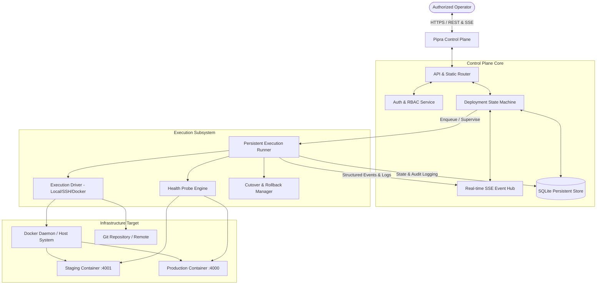

# Pipra Platform Architecture
**Document ID:** `docs/architecture.md`  
**Product:** Pipra — Pipeline & Release Engineering Platform  
**Target Environment:** Self-hosted Control Plane & Execution Agents  
**Revision:** v1.0.0 (Production Architecture)

---

## 1. System Overview

Pipra is an enterprise-grade, self-hosted deployment and release engineering platform built to transform manual deployment scripts into a secure, observable, persistent, and resilient workflow.

The core design principle is **decoupled, autonomous execution**:
The execution engine runs as an independent backend worker process. Browser disconnections, page refreshes, network drops, or UI restarts never disrupt an active deployment.

---

## 2. Core Subsystems

### 2.1 Control Plane
The Control Plane provides:
1. **Web UI & Static Assets:** Served directly with zero external CDN runtime dependencies.
2. **RESTful APIs:** Clean, predictable JSON endpoints for Applications, Environments, Deployments, Stages, Logs, Health Status, Agents, and Audit Logs.
3. **Authentication & RBAC:** Role-based access control with three formal tiers:
   - `admin`: Full administrative control, agent management, user management, and policy overrides.
   - `operator`: Deploy, cancel, retry, and rollback authorization across all configured environments.
   - `viewer`: Read-only access to deployment status, telemetry, metrics, and logs.
4. **Idempotency & Concurrency Manager:** Prevents conflicting simultaneous deployments to the same application/environment target.
5. **Real-time Event Hub (SSE):** Streaming channel for live stage transitions, incremental terminal logs, health-check attempts, and agent connectivity changes. Missed events are replayable from durable history upon client reconnection.

### 2.2 Persistent Storage (SQLite)
Pipra uses Node.js v26 native `node:sqlite` in WAL (Write-Ahead Logging) mode:
- **Zero External Daemon:** Eliminates external DB operational failures while providing full ACID guarantees.
- **Durable History:** Persists applications, environments, deployment executions, stage status records, structured log chunks, health-check probes, release metadata, agent states, users, and audit records.
- **Crash Recovery:** If the Control Plane restarts during an active execution, the worker reconciles non-terminal executions on boot without data loss.

### 2.3 Execution Worker & State Machine
The execution worker operates as a detached, supervisory lifecycle manager:
- Evaluates strict transition guards (`QUEUED` -> `PREPARING` -> `RUNNING` -> `VERIFYING` -> `CUTTING_OVER` -> `SUCCEEDED` or `ROLLING_BACK` -> `FAILED` / `ROLLBACK_FAILED`).
- Implements process isolation, cancellation boundaries, and execution timeouts.
- Redacts sensitive strings (API tokens, passwords, private keys, environment secrets) in real time before logs are persisted or broadcast.

### 2.4 Health Verification & Rollback Engine
- Probes endpoints using exponential backoff or configurable retry intervals (default: 15 retries @ 2s interval).
- Recognizes valid operational HTTP statuses (`200`, `301`, `302`, `304`, `307`, `308`).
- Automatically triggers atomic rollback if post-cutover production health checks fail, restoring and verifying the previous known-good container.

---

## 3. Technology Stack

| Layer | Technology | Rationale |
|---|---|---|
| **Runtime** | Node.js v26 LTS | Native ES Modules, built-in SQLite, zero native compiler dependencies |
| **Persistence** | SQLite (`node:sqlite` WAL mode) | High performance, transaction safety, zero external database setup |
| **API Protocol** | HTTP REST + Server-Sent Events (SSE) | Fast, standards-compliant, connection-resilient without WebSocket handshake overhead |
| **Frontend UI** | HTML5 / Vanilla ES Modules / CSS | High density, zero bundle step requirement, instant startup |
| **Design System** | QA Test Studio Design Tokens | Content-first, WCAG 2.2 AA compliant, dark baseline with accessible contrast |
| **Testing** | Node.js Test Runner (`node:test`, `node:assert`) | Fast native test harness for unit and integration suites |
