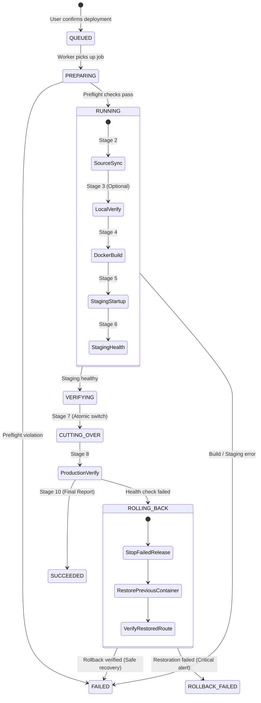

# Pipra Deployment Lifecycle Specification
**Document ID:** `docs/deployment-lifecycle.md`  
**Product:** Pipra — Pipeline & Release Engineering Platform  
**Target Architecture:** Blue-Green / Zero-Downtime Deployment Model  
**Revision:** v1.0.0

---

## 1. Lifecycle Overview

The Pipra deployment engine translates the manual deployment procedure from `deploy_asdp-dims-fe.sh` and `deploy-asyst-web-next.sh` into an automated, 10-stage deterministic state machine with verifiable health gates and automated rollback guarantees.

---

## 2. Stage-by-Stage Specification

### Stage 1: Preflight Validation
- **Goal:** Verify system preconditions before initiating any external side-effects.
- **Checks:**
  1. Operator authorization for target environment (e.g. `production` requires `operator` or `admin` role).
  2. Target application directory exists and is accessible.
  3. Git remote connectivity and validity of branch/tag/commit reference.
  4. Docker daemon operational status and socket access.
  5. Target host port (:4000) and staging port (:4001) conflict analysis.
  6. Concurrency lock: No other active deployment targeting the same application/environment.
  7. Last known-good rollback candidate availability when deploying to `production`.

### Stage 2: Source Synchronization
- **Goal:** Retrieve exact repository state and record immutable provenance.
- **Actions:**
  1. `git fetch --all --prune`
  2. `git checkout <branch_or_tag>`
  3. `git pull origin <branch>` (skipped if commit SHA or explicit tag is supplied, or `--skip-pull` is set).
  4. Extract and persist:
     - Exact commit SHA (`git rev-parse HEAD`)
     - Commit message (`git log -1 --pretty=%B`)
     - Author and timestamp (`git log -1 --pretty=%an <%ae>, %ci`)

### Stage 3: Local Verification (Optional)
- **Goal:** Early compilation check before image building if explicitly configured.
- **Actions:**
  - `npm ci`
  - `npm run build`
- **Output:** Recorded exit code, duration, and stdout/stderr stream. Skipped by default to prevent redundant double builds as Docker multi-stage handles build verification.

### Stage 4: Docker Image Build
- **Goal:** Compile optimized production container image.
- **Actions:**
  - Executes `docker build` using BuildKit caching where available.
  - Passes dynamic build arguments: `--build-arg NODE_ENV=production --build-arg ENV_FILE=<env_file>`.
  - Tags image as `<image_name>:<tag>`.
  - Captures image ID, size, and build duration.
  - Automatically redacts any secret tokens detected in build output.

### Stage 5: Staging Startup
- **Goal:** Boot candidate release on an isolated staging port.
- **Actions:**
  - Cleans up any stale container with the staging name `<name>-staging-<timestamp>`.
  - Launches container on staging port (e.g., `:4001` mapped to container `:3000`).
  - Records container ID, startup parameters, and environment context.
  - Crucial rule: An existing production container is NEVER stopped or disrupted at this stage.

### Stage 6: Staging Health Verification
- **Goal:** Verify that the candidate release is fully operational before routing traffic.
- **Policy:**
  - Probes `http://127.0.0.1:<staging_port>/`.
  - Acceptable HTTP status codes: `200`, `301`, `302`, `304`, `307`, `308`.
  - Max retries: 15 attempts.
  - Interval: 2 seconds between attempts.
  - Timeout: 2s connection timeout, 4s request duration.
- **Failure Handling:** If all 15 attempts fail, staging container is safely removed, active production container remains untouched, and deployment transitions to `FAILED`.

### Stage 7: Production Cutover
- **Goal:** Execute sub-second, near-zero-downtime cutover.
- **Actions:**
  1. Stop and remove the temporary staging container (`<name>-staging-<timestamp>`).
  2. Rename currently serving production container `<name>` to `<name>-backup-<timestamp>`.
  3. Stop `<name>-backup-<timestamp>` with a fast graceful timeout (`docker stop -t 2`).
  4. Launch candidate image as `<name>` binding to production port (e.g., `:4000`).
  - Total cutover window: Typically under 500ms.

### Stage 8: Production Verification
- **Goal:** Independent verification of real production route.
- **Actions:**
  - Sleep 2 seconds for server initialization.
  - Probe `http://127.0.0.1:<host_port>/`.
  - Validate response code against accepted status list.
  - Staging success is never assumed as proof of production success.

### Stage 9: Automatic Rollback
- **Trigger:** Production verification returns non-matching HTTP code or connection failure.
- **Actions:**
  1. Capture diagnostic logs from the failed new container.
  2. Remove failed container `<name>`.
  3. Restart `<name>-backup-<timestamp>`: `docker start <name>-backup-<timestamp>`.
  4. Rename back: `docker rename <name>-backup-<timestamp> <name>`.
  5. Probe production port again to verify restored service.
- **Outcomes:**
  - Restored verified: Deployment marked `FAILED` with `rollback_status: "SUCCESSFUL"`. Live traffic preserved.
  - Restoration failed: Deployment marked `ROLLBACK_FAILED` with high-severity emergency alert.

### Stage 10: Final Report & Provenance
- **Goal:** Complete operational transparency and audit record.
- **Metrics Persisted:**
  - Deployment ID, Application, Environment, Status (`SUCCEEDED`, `FAILED`, `ROLLBACK_FAILED`, `CANCELLED`).
  - Operator identity (username, IP, timestamp).
  - Git commit SHA, branch/tag, commit message.
  - Container IDs, Image ID, Host port, Staging port.
  - Individual stage execution times and cumulative deployment duration.
  - Health probe results and rollback status.
